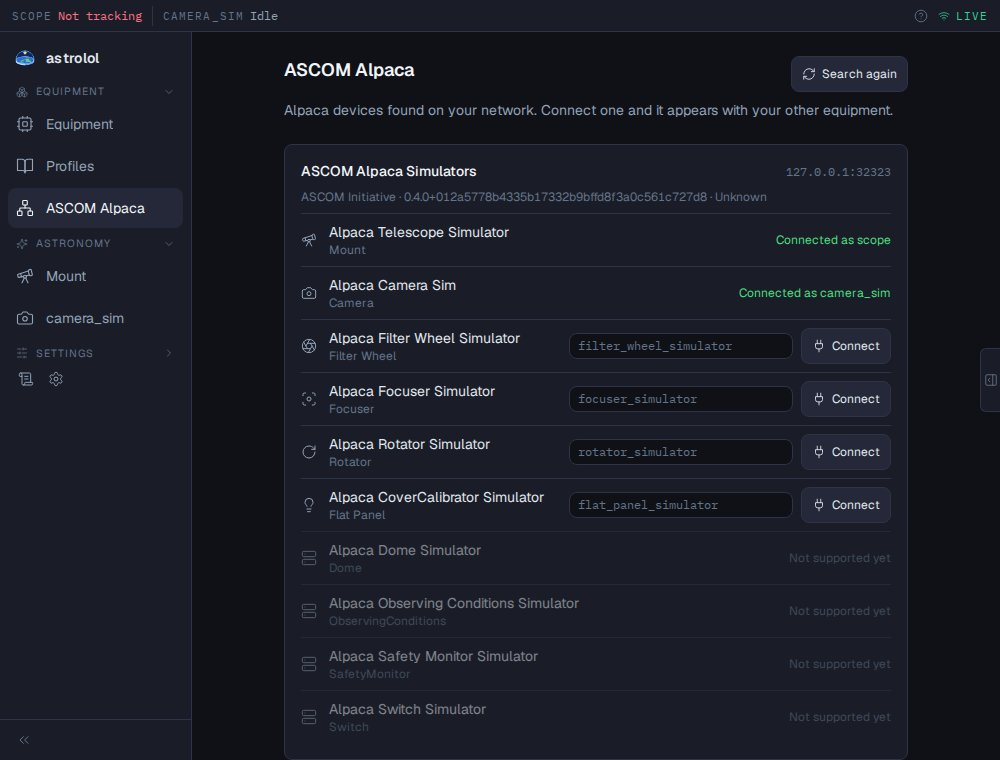

# ASCOM Alpaca

Connects cameras, mounts, focusers, filter wheels, rotators and flat panels (cover
calibrators) that speak ASCOM Alpaca over the network: devices with Alpaca built in, Windows
ASCOM drivers shared with ASCOM Remote, and ASCOM's OmniSim simulators.

Turn the plugin on in [Options → Plugins](../../../../docs/en/options.md#plugins) (astrolol
restarts), then open **Alpaca** in the Equipment section of the menu.



## Finding devices

The page searches the network when it opens; **Search again** repeats it. Each Alpaca server
found is listed with its name, its address and its devices. The search reaches servers on the
same network as astrolol; a server elsewhere (another subnet, a VPN) can be added under
**Servers to ask directly**, as `host` or `host:port` (port 11111 when none is given). Those
addresses are kept and asked at every search. An address that does not answer is reported
under the list.

Devices of a kind astrolol does not handle yet (domes, switches, weather stations, safety
monitors) are shown greyed out.

## Connecting a device

Each device has a **Device ID**, the name used everywhere in astrolol (menu entries, file
names), and a **Connect** button. The ID suggested in grey is used if you leave the field empty.
Once connected, the device shows **Connected as** its ID, and works like any other device of
its kind: the camera on its imaging page, the mount on the Mount page, and so on. It can be
added to the inventory and to profiles from the [Equipment](../../../../docs/en/equipment.md)
page, which reconnects it the same way.

Devices can also be connected from the Equipment page's wizard: **Other adapter**, the
`alpaca_…` adapter of that kind, and where the device is:

```json
{"host": "192.168.1.20", "port": 11111, "device_number": 0}
```

`device_number` tells apart several devices of the same kind on one server (0 for the first).

## Good to know

- Alpaca cameras send pixels rather than files: astrolol writes the FITS file, with exposure,
  binning, gain, temperature, pixel size and Bayer pattern in its header.
- Alpaca devices do not report changes by themselves: astrolol asks them, once a second for a
  mount's position, so the display can lag by up to a second.
- A mount moved by hand is stopped when it is disconnected.
