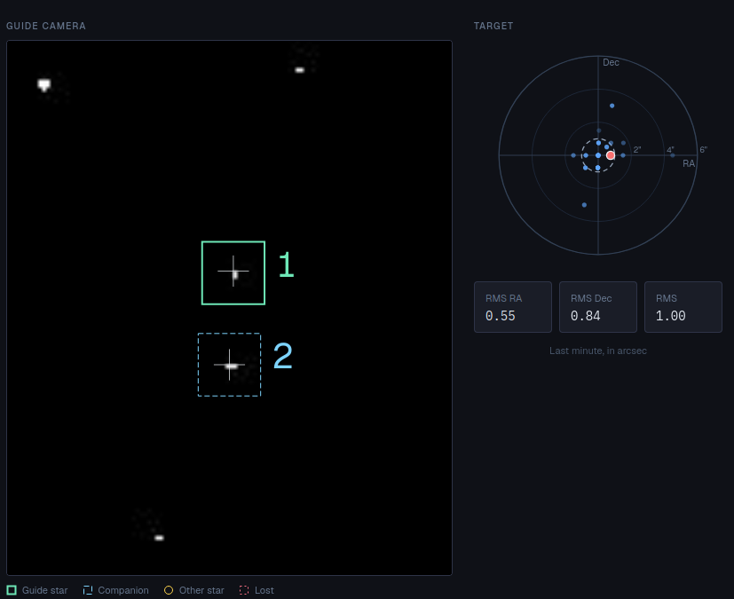

# Guider

> **Experimental.** The built-in guider has mostly been tested with simulators and still needs
> testing on real equipment. Keep an eye on it during your first nights, and keep
> [PHD2](../../phd2/docs/en.md) at hand as a fallback. Problems you report help make it reliable.

*Plugin: Built-in Guider.* Keeps a star on the same spot of a guide camera while you image,
by sending small corrections to the mount. It needs no other program. Do not enable it
together with [PHD2 Guiding](../../phd2/docs/en.md) or the [Guide Simulator](../../guide_simulator/docs/en.md).

## Quick start

1. In **Set-up**, choose the **Guide camera**.
2. Click **Start guiding**.

The first time, the guider calibrates: it moves the mount a little in each direction to learn
how the star moves. Then it picks guide stars and starts correcting. The calibration is kept
and reused, even after a slew or a meridian flip.

## The page

**Guide camera.** The live guide frame. Boxes mark the **Guide star** (numbered), its
**Companions** (other stars averaged in to beat the seeing), **Other stars** and **Lost** stars.
**Show camera** displays frames without guiding, to check focus and framing; click a star to
guide on it, or let the guider choose (**Choose the star for me**). Under the image, a line
gives the frame number, exposure, background, noise and brightest pixel; a table gives each
star's HFD, FWHM, SNR and peak (and marks it *saturated*, *smeared* or *left out*).

**Target.** Where the star has been over the last minute, around the aim point, with the
**RMS RA**, **RMS Dec** and total **RMS** in arcseconds (or pixels when the image scale is
unknown). Below 1″ total is good for most setups.

**Guide error graph.** RA and Dec error over time, with the corrections as bars. Scale in
**arcsec** or **pixels**, or **Auto**.

**Guiding** box: state (*Choosing a star*, *Calibrating*, *Guiding*, *Paused*…), how long it has
been guiding or not guiding, star losses, declination and pier side, the measured **drift** and
**periodic error**, the star's SNR.

**Buttons**: **Start guiding**, **Stop**, **Pause** / **Resume**, **Dither** (moves the aim point
by the **Dither distance**, then waits for the star to settle), **Calibrate again**.

## Set-up tab

| Setting | |
|---|---|
| Guide camera | Any connected camera. |
| Send corrections through | **Guide camera** (an ST4 cable from the camera to the mount) or **Mount** (through the mount's driver). |
| Mount | Lets the calibration follow slews and meridian flips. Normally *The connected mount*. |
| Exposure, Gain, Binning | For the guide frames. 1–3 s is typical. Empty gain leaves the camera's gain as it is. |
| Guide stars | How many stars to use. More stars average the seeing out. |
| Pixel scale | Arcseconds per pixel. Calculated from the guide scope and camera in the profile; type it only if that is missing. |
| Give up after | How long to look for a lost star (behind a cloud, say). 0 = until it comes back. |

## Corrections tab

Fine-tuning. The defaults suit most mounts; change one thing at a time.

| Setting | |
|---|---|
| RA / Dec aggressiveness | Share of the error corrected at each frame. Lower if the error keeps overshooting. |
| RA hysteresis | Share of the previous correction kept, to smooth corrections. |
| Minimum move | Errors smaller than this are seeing, not drift, and are left alone. **Automatic** or a set value. |
| Longest correction | Upper limit of one correction pulse. |
| Dec corrections | **Both ways**, **North only**, **South only** or **Off**. One way only avoids Dec backlash on a mount that drifts one way. |
| Resist Dec reversals | Change Dec direction only when several frames in a row, or one large error, ask for it. |
| Compensate Dec backlash | Lengthen the first Dec correction after a reversal by the backlash measured at calibration. |
| Dec after a meridian flip | Whether North pulses move the star the other way after a flip. **Automatic** is fine: guiding notices a wrong choice and corrects it. |
| Predict drift | Learn how the mount drifts and correct it ahead. |
| Predict periodic error | Learn the regular wobble of the RA gears and correct it ahead. **RA worm period**: the time of one worm turn, if you know it, or **Find it**. |

## Calibration tab

Shows the current calibration: **RA speed** and **Dec speed**, **Angle between axes**,
**Dec backlash** and **RA backlash**, **Drift**, **Scatter**, **Distance RA / Dec**, where and
when it was made, and a graph of the measurements (**Show**). *The measurements agree well*,
or warnings with advice, for example:

- *The measurements scatter a lot*: steadier air, a longer exposure or a brighter star.
- *The star moved only a short distance*: increase the calibration **Distance**.
- *RA and Dec are not at right angles*: check for backlash or a loose mount.
- *Calibrated close to the pole*: calibrate again nearer the celestial equator.

Settings: **Steps per direction** and **Distance** (how far calibration moves the star).
**Forget calibration** makes the next run calibrate again.

Calibrate once near the celestial equator and near the meridian; astrolol adjusts it to
wherever the mount points afterwards.

## Dark frames tab

Darks remove hot pixels around the guide star. Cover the telescope, choose the number of
**frames** and click **Take dark**: a dark is taken with the exposure and gain from Set-up. The
list shows the darks you have, with their hot-pixel count, and whether one matches the current
exposure and gain. **Delete darks** removes them.

## When things go wrong

The guider keeps going through passing clouds, a lost star, a refused correction, a camera that
stops sending frames for a while or a meridian flip, and tells you why it is not guiding
(*star lost*, *the mount refuses corrections*, *no frames from the camera*…). The menu entry
shows a red dot while it needs attention. The [Sequencer](../../sequencer/docs/en.md) waits for guiding to
come back before it takes the next frame.
