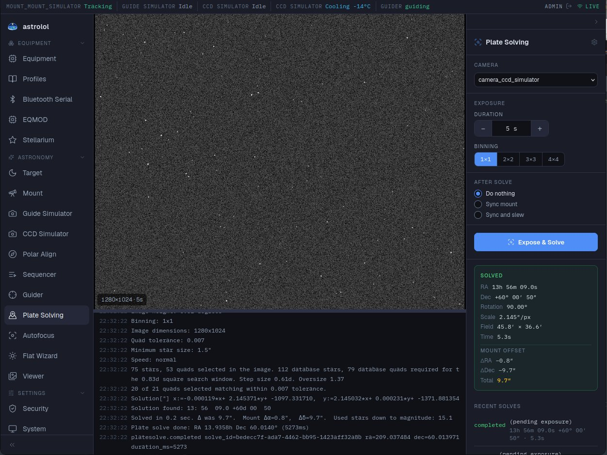

# Plate Solving

*Plugin: Plate Solving.* Takes a frame, finds where in the sky it was taken by matching its
stars against a star catalogue, and can correct the mount with the result. This is how you
centre a target precisely, whatever the mount's own pointing accuracy.

## Before the first use

Plate solving uses **ASTAP** or **Asterion**, which must be installed on the telescope computer,
together with their star data. Asterion solves much faster (a few milliseconds instead of
seconds, and far less when the position is not known), but it is a newer program; ASTAP is the
established one. Open the settings (gear at the top of the panel):

| Setting | |
|---|---|
| Solver | Which program solves. **ASTAP** is the default. |
| Try the other solver when this one finds nothing | A second chance with the other program before the solve is reported as failed. |
| Program | The program of the chosen solver, shown here. Set in the configuration file `/etc/astrolol/astrolol.toml` (`astap_program`, `asterion_program`). |
| Star data | The folder holding the star database (ASTAP: `astap_database`) or catalogs (Asterion: `asterion_catalog_dir`), shown here. If it is missing, **Install d05** (ASTAP) or **Install catalog** (Asterion) downloads it; either suits most setups. The Asterion catalog suits fields wider than 0.7°. |
| Search radius (°) | How far from the mount's position to search. Larger is slower but tolerates a worse pointing. |
| Tolerance | How strictly star patterns must match (ASTAP only). |
| Pixel size (µm, optional) | Only if the camera does not report it. |

The image scale comes from the telescope's focal length and the camera's pixel size in the
[inventory](../../../../docs/en/equipment.md#inventory), so fill those in.

## Solving

1. **Camera**: the camera to take the frame with.
2. **Exposure**: duration and binning. A few seconds at 2×2 is usually enough.
3. **After solve**:
   - **Do nothing**: just tell me where I am.
   - **Sync mount**: correct the mount's idea of where it points.
   - **Sync and slew**: correct it, then slew to the mount's target again. This is the usual
     choice after a GoTo: run **Expose & Solve** again until the mount offset is small enough.
4. Click **Expose & Solve**. **Halt** stops it.

The frame is shown in the middle with the solver's log below it (drag the divider to resize).

## The result

The **Solved** box shows:

- **RA / Dec** of the image centre, **Rotation** of the camera, **Scale** (″ per pixel) and
  **Field** of view;
- the **Mount offset** (ΔRA, ΔDec, Total): how far the mount's reported position was from the
  truth.

**Recent solves** lists the last attempts with their outcome and the solver that found them.

If a solve fails: check focus, try a longer exposure, check the focal length and pixel size,
and widen the search radius if the mount may be far off.

Plate solving is also used by [Polar Align](../../polar_align/docs/en.md) and by the
[Sequencer](../../sequencer/docs/en.md) to centre each target.
