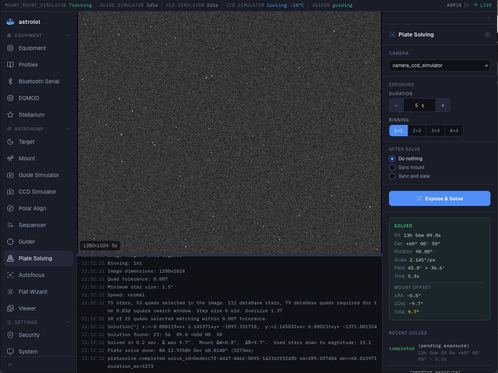

# Résolution astrométrique

*Module : Résolution astrométrique.* Prend une image, trouve où elle a été prise dans le ciel en
comparant ses étoiles à un catalogue, et peut corriger la monture avec le résultat. C'est ainsi
qu'on centre précisément une cible, quelle que soit la précision de pointage de la monture.



## Avant la première utilisation

La résolution astrométrique utilise **ASTAP** ou **Asterion**, qui doivent être installés sur
l'ordinateur du télescope avec leurs données d'étoiles. Asterion résout bien plus vite (quelques
millisecondes au lieu de plusieurs secondes, et encore plus quand la position est inconnue),
mais c'est un programme plus récent ; ASTAP est le programme éprouvé. Ouvrez les réglages (roue
dentée en haut du panneau) :

| Réglage | |
|---|---|
| Solveur | Le programme qui résout. **ASTAP** par défaut. |
| Essayer l'autre solveur quand celui-ci ne trouve rien | Une seconde chance avec l'autre programme avant de déclarer l'échec. |
| Programme | Le programme du solveur choisi, affiché ici. Se règle dans le fichier de configuration `/etc/astrolol/astrolol.toml` (`astap_program`, `asterion_program` ; celui d'Asterion ne sert que sans son paquet Python). |
| Données d'étoiles | Le dossier de la base d'étoiles (ASTAP : `astap_database`) ou des catalogues (Asterion : `asterion_catalog_dir`), affiché ici. S'il manque, **Installer d05** (ASTAP) ou **Installer le catalogue** (Asterion) le télécharge ; l'un comme l'autre convient à la plupart des setups. Le catalogue d'Asterion convient aux champs de plus de 0,7°. |
| Rayon de recherche (°) | Jusqu'où chercher autour de la position de la monture. Plus grand, c'est plus lent mais tolère un pointage moins bon. |
| Tolérance | La rigueur avec laquelle les motifs d'étoiles doivent correspondre (ASTAP seulement). |
| Taille de pixel (µm, facultatif) | Seulement si la caméra ne la donne pas. |

L'échantillonnage vient de la focale du télescope et de la taille de pixel de la caméra dans
l'[inventaire](../../../../docs/fr/equipment.md#inventaire) : renseignez-les.

## Utiliser Asterion

1. Installez-le : `pip install asterion-solver` dans l'environnement Python d'astrolol, puis
   redémarrez astrolol. Sans le paquet, astrolol lance le programme `asterion` : téléchargez la
   version Linux sur <https://github.com/asterion-solver>, décompressez-la et placez le fichier
   `asterion` dans un dossier du `PATH` (par exemple `~/.local/bin`). S'il est ailleurs,
   renseignez `asterion_program` dans `/etc/astrolol/astrolol.toml`. Le paquet est préférable :
   il garde les catalogues en mémoire entre deux résolutions, donc chaque résolution est plus rapide.
2. Ouvrez les réglages et choisissez **Asterion** comme **Solveur**. Si les données d'étoiles
   manquent, un bandeau propose **Installer le catalogue** : il télécharge le catalogue Tycho-2
   (environ 300 Mo, avec la progression dans le journal). Il convient aux champs de plus de 0,7° ;
   un champ plus étroit demande un des catalogues plus gros (1,5 Go et plus), installé avec
   `asterion --download-catalog` dans un terminal.
3. Résolvez comme d'habitude. Asterion n'a pas besoin de position : si celle de la monture est
   inconnue ou très fausse, il trouve quand même le champ, le rayon de recherche compte donc peu.

Laissez activé **Essayer l'autre solveur quand celui-ci ne trouve rien** pour garder ASTAP en
secours ; la liste **Résolutions récentes** indique quel programme a trouvé chaque solution.

Pour comparer les deux sur vos propres images (taux de réussite, durée, accord), lancez dans un
terminal de l'ordinateur du télescope :

```
python3 -m astrolol.plugins.platesolve.benchmark /chemin/vers/images --repeat 3
```

Chaque fichier FITS est résolu avec les deux programmes, avec et sans la position indiquée, et un
tableau s'affiche ; `--help` liste les options (variantes de test comme une image recadrée ou plus
bruitée, sortie JSON).

## Résoudre

1. **Caméra** : la caméra qui prend l'image.
2. **Pose** : durée et binning. Quelques secondes en 2×2 suffisent en général.
3. **Après la résolution** :
   - **Ne rien faire** : juste savoir où l'on est.
   - **Synchroniser la monture** : corriger l'idée que la monture se fait de son pointage.
   - **Synchroniser et pointer** : la corriger, puis repointer la cible de la monture. C'est le
     choix habituel après un GoTo : relancez **Poser et résoudre** jusqu'à ce que l'écart de la
     monture soit assez faible.
4. Cliquez sur **Poser et résoudre**. **Arrêter** l'interrompt.

L'image s'affiche au centre avec le journal du solveur en dessous (faites glisser la séparation pour
redimensionner).

## Le résultat

Le cadre **Résolu** affiche :

- l'**AD / Dec** du centre de l'image, la **Rotation** de la caméra, l'**Échelle** (″ par pixel)
  et le **Champ** ;
- l'**Écart de la monture** (ΔAD, ΔDec, Total) : la distance entre la position annoncée par la
  monture et la réalité.

**Résolutions récentes** liste les dernières tentatives, leur issue et le solveur qui a trouvé la solution.

Si une résolution échoue : vérifiez la mise au point, essayez une pose plus longue, vérifiez la
focale et la taille de pixel, et élargissez le rayon de recherche si la monture peut être loin.

La résolution astrométrique sert aussi à la [Mise en station](../../polar_align/docs/fr.md) et au
[Séquenceur](../../sequencer/docs/fr.md) pour centrer chaque cible.
