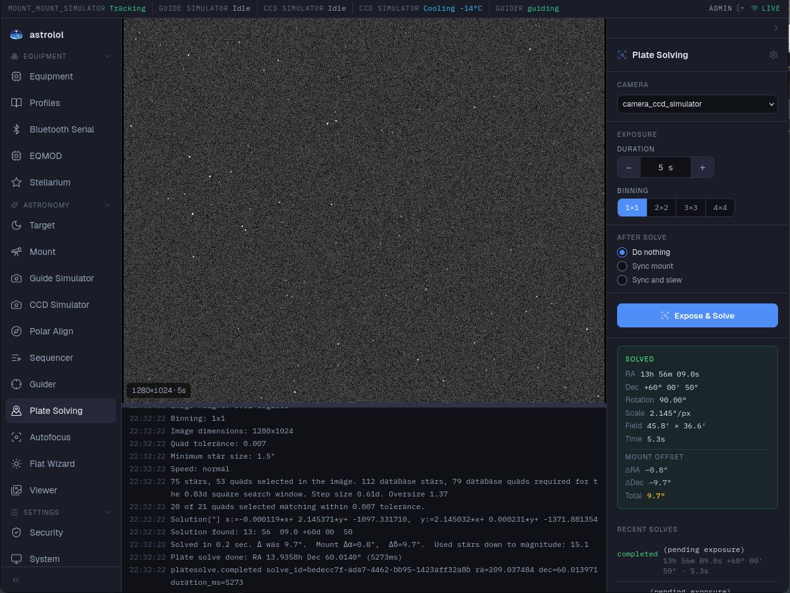

# Résolution astrométrique

*Module : Résolution astrométrique.* Prend une image, trouve où elle a été prise dans le ciel en
comparant ses étoiles à un catalogue, et peut corriger la monture avec le résultat. C'est ainsi
qu'on centre précisément une cible, quelle que soit la précision de pointage de la monture.

## Avant la première utilisation

La résolution astrométrique utilise **ASTAP**, qui doit être installé sur l'ordinateur du
télescope avec une base d'étoiles. Ouvrez les réglages (roue dentée en haut du panneau) :

| Réglage | |
|---|---|
| Exécutable ASTAP | Le programme ASTAP qu'astrolol lance, affiché ici. Se règle dans le fichier de configuration `/etc/astrolol/astrolol.toml` (`astap_program`). |
| Chemin de la base d'étoiles | Le dossier de la base d'étoiles, affiché ici (`astap_database` dans le fichier de configuration). Si elle manque, **Installer d05** télécharge et installe la base D05, qui convient à la plupart des setups. |
| Rayon de recherche (°) | Jusqu'où chercher autour de la position de la monture. Plus grand, c'est plus lent mais tolère un pointage moins bon. |
| Tolérance | La rigueur avec laquelle les motifs d'étoiles doivent correspondre. |
| Taille de pixel (µm, facultatif) | Seulement si la caméra ne la donne pas. |

L'échantillonnage vient de la focale du télescope et de la taille de pixel de la caméra dans
l'[inventaire](../../../../docs/fr/equipment.md#inventaire) : renseignez-les.

## Résoudre

1. **Caméra** : la caméra qui prend l'image.
2. **Pose** : durée et binning. Quelques secondes en 2×2 suffisent en général.
3. **Après la résolution** :
   - **Ne rien faire** : juste savoir où l'on est.
   - **Synchroniser la monture** : corriger l'idée que la monture se fait de son pointage.
   - **Synchroniser et pointer** : la corriger, puis repointer la cible de la monture. C'est le
     choix habituel après un GoTo : relancez **Poser et résoudre** jusqu'à ce que l'écart de la
     monture soit assez faible.
4. Cliquez sur **Poser et résoudre**. **Arrêter** l'interrompt.

L'image s'affiche au centre avec le journal d'ASTAP en dessous (faites glisser la séparation pour
redimensionner).

## Le résultat

Le cadre **Résolu** affiche :

- l'**AD / Dec** du centre de l'image, la **Rotation** de la caméra, l'**Échelle** (″ par pixel)
  et le **Champ** ;
- l'**Écart de la monture** (ΔAD, ΔDec, Total) : la distance entre la position annoncée par la
  monture et la réalité.

**Résolutions récentes** liste les dernières tentatives et leur issue.

Si une résolution échoue : vérifiez la mise au point, essayez une pose plus longue, vérifiez la
focale et la taille de pixel, et élargissez le rayon de recherche si la monture peut être loin.

La résolution astrométrique sert aussi à la [Mise en station](../../polar_align/docs/fr.md) et au
[Séquenceur](../../sequencer/docs/fr.md) pour centrer chaque cible.
