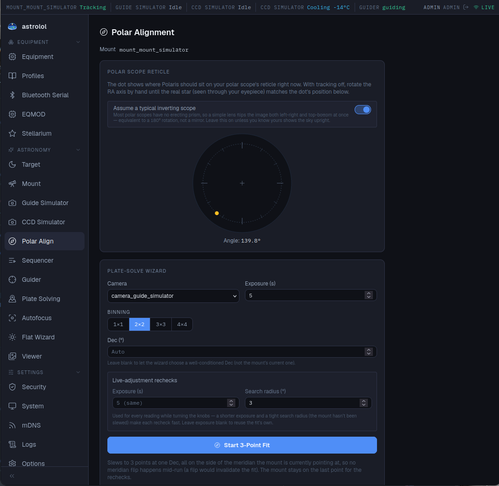

# Polar Align

*Plugin: Polar Alignment.* Two ways to aim the mount's polar axis at the celestial pole: a
polar scope reticle, and a plate-solving wizard that measures the error and guides you while
you turn the adjustment knobs. A mount and a camera must be connected, and the site set in the
active profile.

## Polar scope reticle

For mounts with a polar scope. The dot shows where Polaris should sit on the reticle right now,
with its **Angle**.

1. Turn tracking off.
2. Rotate the RA axis by hand until the reticle in your polar scope is oriented like the
   drawing.
3. Use the altitude and azimuth knobs to put Polaris where the dot is.

**Assume a typical inverting scope** is on by default: most polar scopes show the sky rotated
by 180°. Turn it off only if yours shows the sky upright.

## Plate-Solve Wizard

More precise, and it works without seeing the pole (the southern hemisphere has no bright
pole star). It needs [Plate Solving](../../platesolve/docs/en.md) to be set up.

**Settings**

- **Camera**, **Exposure**, **Binning**: for the solves. The main camera or the guide
  camera both work.
- **Dec (°)**: the declination of the three points. Leave it on *Auto* to let the wizard choose
  a good one.
- **Live-adjustment rechecks**: exposure and search radius used while you turn the knobs. A
  short exposure and a small radius make each reading quicker. The radius widens by itself when
  the initial error is large.

**Running it**

1. Click **Start 3-Point Fit**. The mount slews to three points at the same declination, on the
   side of the meridian it currently points at, and solves at each one (*Point 1 / 3*…).
2. The **Initial fit** shows the error with what to do, as arrows (up or down for the altitude
   knob, left or right for the azimuth knob, seen from behind the mount facing the pole) with the
   angle to move in degrees, arcminutes and arcseconds, and a rating (*Excellent*, *Good*,
   *Fair*, *Needs work*).
3. Turn the altitude and azimuth knobs the way the arrows point. Then click **Recheck now**:
   the **Latest reading** shows the arrows for what remains. No new slew is needed.
   With **Auto-refresh** on (every 3 seconds by default), a reading is taken without clicking; it
   keeps going even if you close the page.
4. Repeat until the rating is good enough, then click **Done**.

**Live star view**

Faster than rechecks once the error is down to a few arcminutes. Click **Start live view**: the
wizard solves the field once, picks a bright star and follows it on the camera, several times a
second.

- The **ring** is where the star has to end up. Turn the knobs until the star is inside it.
- The blue solid arrow shows how the azimuth knob moves the star, the violet dashed arrow how
  the altitude knob does. The arrows below the picture give the remaining angle, as above.
- When the star is on the mark, the page says so (within 30″).
- If clouds hide the star, the view waits and picks it up again when it returns.
- **Exposure** is the length of each frame: raise it if the star is faint.

If the error is still large, no star stays in the frame while the knobs are turned: the view says
so. Use rechecks until the error is smaller. The live view and rechecks share the camera, so
only one of them runs at a time.

**Cancel** stops the run; **Start New Fit** starts over (for example after moving the tripod).

Tips: lock the knobs gently between readings, and do not touch the RA or Dec clutches during
the run, as this would invalidate the fit.
