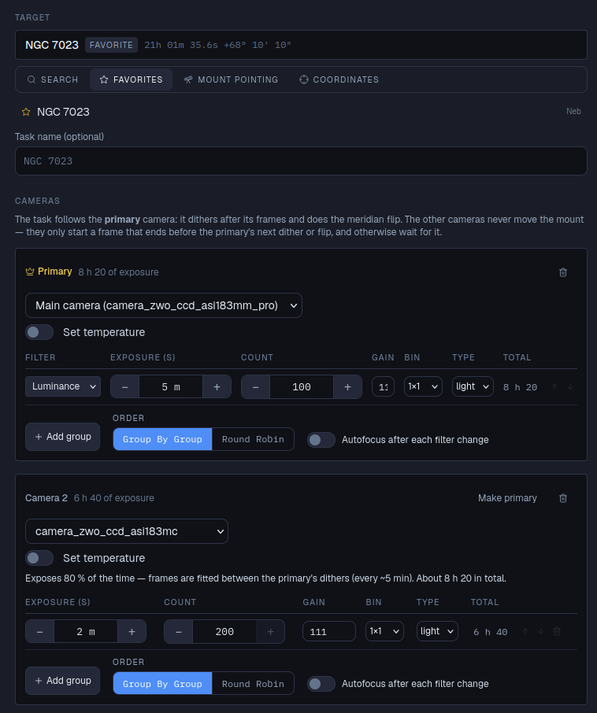
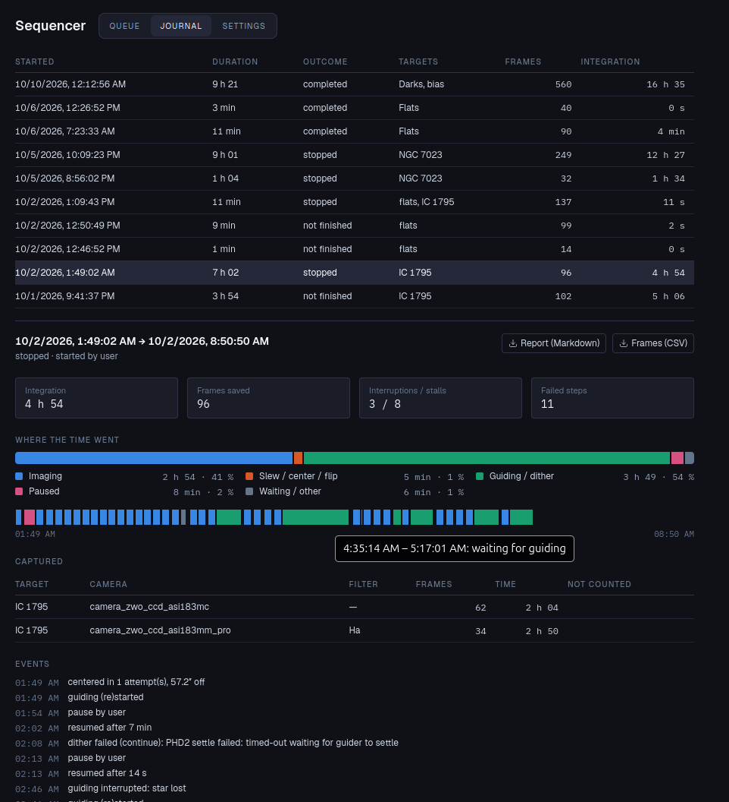

# Séquenceur

*Module : Séquenceur.* Planifie et exécute une nuit d'imagerie : une file de tâches, chacune une
cible et les images à prendre dessus. Pour chaque tâche, le séquenceur peut pointer, centrer,
lancer le guidage, faire la mise au point, puis prendre les images, avec un dithering entre elles
et un retournement au méridien si besoin. On peut le mettre en pause, l'arrêter et le reprendre
à tout moment, et il écrit un journal de chaque exécution.

La page a trois onglets : **file**, **journal** et **réglages**.

## La file

La file est la liste des tâches, exécutées de haut en bas. Chaque carte montre la cible, le plan
(*pointage · centrage · guidage · dither toutes les 3 · en cas d'erreur : pause*…), la
progression (*12/40 images · 1 h / 3 h 20*) et l'état : *en attente*, *en cours*, *interrompue*,
*terminée*, *échec* ou *ignorée*.

- **Ajouter une tâche** ouvre l'éditeur de tâche.
- Faites glisser les cartes pour les réordonner.
- **Effacer les terminées** retire les tâches terminées.
- **Séquences…** enregistre et charge des files entières (voir plus bas).

Le menu **⋯** d'une carte : **Modifier**, **Dupliquer**, **Télécharger comme fichier**,
**Démarrer d'ici** (les tâches en attente précédentes sont laissées pour plus tard), **Passer à
cette tâche** (après l'image en cours ; la tâche actuelle garde sa progression), **Ignorer** /
**Ne plus ignorer**, **Réinitialiser la progression**, **Supprimer**. Supprimer une tâche ne
supprime jamais les images déjà sur le disque.

## Ajouter une tâche

**Cible.** Quatre façons de la choisir :

- **Recherche** : un objet de catalogue ou une planète (les planètes sont recalculées au démarrage
  de la tâche, pour que la position soit à jour).
- **Favoris** : ceux de la page [Cible](../../target/docs/fr.md).
- **Pointage de la monture** : ni pointage ni centrage ; la tâche photographie là où la monture
  pointe à son démarrage. Pour les flats, les darks, ou un cadrage réglé à la main. Le nom est
  facultatif et sert seulement à étiqueter les images.
- **Coordonnées** : AD en heures (`5 35 17` ou `5.588`), Dec en degrés (`-5 23 28` ou `-5.39`),
  J2000.

**Nom de la tâche** (facultatif) : par défaut, le nom de la cible.

**Caméras.** Choisissez la caméra, éventuellement **Régler la température**, puis ajoutez une
ligne par groupe d'images :

| Colonne | |
|---|---|
| Filtre | Quand la caméra a une roue à filtres dans le profil. |
| Pose (s) | |
| Nombre | Nombre d'images. |
| Gain, Bin, Type | Gain (vide = défaut de la caméra), binning, type d'image (light, dark, flat, bias). |
| Total | Temps de pose de la ligne. |

**Ajouter un groupe** ajoute une ligne ; les flèches réordonnent les lignes. **Ordre** :
**Groupe par groupe** prend toutes les images d'une ligne avant la suivante ; **Alternance**
passe d'une ligne à l'autre, **Images par tour** à la fois, pour avoir un peu de chaque filtre
même si la nuit est écourtée. **Autofocus après chaque changement de filtre** refait la mise au
point quand le filtre change.

**Plusieurs caméras.** **Ajouter une caméra** pour imager avec deux caméras ou plus sur la même
monture (par exemple une caméra mono et une caméra couleur sur deux instruments). La caméra
**Principale** mène : la tâche fait le dither après ses images et le retournement au méridien.
Les autres caméras ne déplacent jamais la monture : elles ne démarrent une image que si elle se
termine avant le prochain dither ou retournement de la principale, sinon elles attendent. Sous
chaque caméra secondaire, astrolol indique quelle part du temps elle posera réellement ; des
poses plus courtes sur la secondaire gaspillent moins. **Définir comme principale** change la
caméra qui mène.

**Avant l'imagerie**, chacun facultatif. Quand l'une des trois premières s'exécute, le suivi est
d'abord activé si la monture ne suivait pas :

- **Pointer la cible**
- **Centrer par résolution astrométrique** (nécessite la
  [Résolution astrométrique](../../platesolve/docs/fr.md))
- **Démarrer le guidage (attendre la stabilisation)** (nécessite un guideur)
- **Autofocus** (nécessite l'[Autofocus](../../autofocus/docs/fr.md))
- **Attendre que les caméras atteignent la température**
- **Panneau de flats : fermer le cache et l'allumer, l'ouvrir ensuite** : pour les flats. Le
  cache du panneau de flats placé sous le télescope de la caméra dans le profil est fermé et la
  lumière allumée avant les images ; la lumière est éteinte et le cache ouvert quand la tâche
  se termine, se met en pause ou échoue. Une colonne **Panneau** apparaît dans le tableau des
  poses pour régler la luminosité de chaque ligne (vide = ne pas toucher au panneau), chaque
  filtre peut donc avoir la sienne. Activer cette option désactive aussi le pointage, le
  centrage, le guidage et le dithering, inutiles pour des flats.

**Pendant l'imagerie** : **Dither toutes les** *n* images de la principale, et un **Délai entre
les images** facultatif.

**Si une étape échoue** :

| Choix | Ce qui se passe |
|---|---|
| pause | Toute l'exécution se met en pause ; **Reprendre** relance l'étape en échec. |
| ignorer | Cette tâche est marquée en échec et la suivante démarre. |
| reporter | Cette tâche est mise de côté (reprenable plus tard) et la suivante démarre. |
| arrêter | Toute l'exécution s'arrête. |

Cliquez sur **Ajouter à la file** (ou **Enregistrer les modifications** en modification). Quand
vous modifiez une tâche déjà commencée, les images déjà prises sont conservées pour les lignes
dont le filtre, la durée, le gain, le binning et le type n'ont pas changé.

## Exécution

La barre au-dessus de la file :

- **Démarrer** (ou **Démarrer / reprendre**) exécute la file à partir de la première tâche non
  terminée. Les problèmes qui empêcheraient l'exécution (pas de caméra, un filtre qui n'existe
  pas…) sont signalés d'abord, sur les tâches concernées.
- **Pause** met en pause après l'image en cours. Son menu propose aussi *Pause après cette
  tâche* et *Pause immédiate* (interrompt la pose en cours ; cette image est perdue).
  **Reprendre** continue.
- **Arrêter**, avec les trois mêmes choix.
- **Passer la tâche** passe à la tâche suivante.

Pendant l'exécution, la barre montre la tâche et l'activité en cours (*Pointage*, *Centrage*,
*Démarrage du guidage*, *Mise au point*, *Pose*, *Dithering*, *Retournement au méridien*…), la
pose en cours pour chaque caméra, le nombre de tâches terminées et le temps de pose restant.

La progression est enregistrée au fur et à mesure. Si astrolol, l'ordinateur ou le réseau
tombe, relancez et la file reprend là où elle en était ; une tâche interrompue par une longue
pause est recentrée avant de continuer.

**Quand quelque chose se passe mal**, le séquenceur essaie de sauver la nuit :

- **Le guidage est interrompu** : il attend le retour du guidage avant l'image suivante, retente
  régulièrement de démarrer le guidage, recentre une fois si le guidage reste interrompu, et peut
  reprendre les images prises sans guidage.
- **Le centrage ne trouve aucune étoile** ou **L'autofocus échoue** (nuages) : il réessaie
  automatiquement. Pendant un blocage de l'autofocus, l'imagerie continue à la dernière bonne
  mise au point.
- La barre indique ce qui est bloqué, depuis quand, et quand aura lieu la prochaine tentative.
  Passez à une autre tâche ou arrêtez si le ciel ne se dégage pas. Avec **Abandonner un blocage
  après** renseigné, la tâche est traitée comme une étape en échec passé ce délai.

**En pause à cause d'une erreur** : la barre affiche l'erreur. **Reprendre (réessayer)** relance
l'étape en échec ; **Passer la tâche** continue.

## Séquences

**Séquences…** ouvre la bibliothèque :

- **Enregistrer la file comme séquence** : un nom, une description facultative, et le choix
  d'**Exclure les tâches terminées**. Seule la définition est enregistrée (cibles, caméras,
  poses, options), pas la progression.
- **Séquences enregistrées** : **Charger** ajoute des copies neuves des tâches à la file ; on
  peut aussi les télécharger ou les supprimer.
- **Fichiers** : **Télécharger la file** comme fichier, **Ajouter un fichier à la file**, ou
  **Ajouter un fichier aux séquences enregistrées**. Pratique pour préparer un plan sur un autre
  astrolol ou pour garder des sauvegardes.

## Journal

Un journal est écrit à chaque exécution. La liste montre quand chaque exécution a commencé,
sa durée, son résultat, ses cibles, le nombre d'images et l'intégration totale. Cliquez sur une
exécution pour voir :

- **Intégration**, **Images enregistrées** (et combien n'ont pas été comptées), **Interruptions /
  blocages**, **Étapes en échec** ;
- **Répartition du temps** : une barre et une frise chronologique de l'imagerie, des pointages /
  centrages / retournements, du guidage / dithering, de la mise au point, des pauses et de
  l'attente. Survolez la frise pour le détail ;
- **Capturé** : images et durée par cible, caméra et filtre ;
- **Événements** : résultats de centrage, interruptions du guidage, autofocus, retournements,
  pauses, échecs ;
- **Images** : chaque image avec son heure, sa cible, sa caméra, son filtre, sa pose, le RMS du
  guidage, le temps non guidé, la hauteur, la position de mise au point et la température du
  capteur.

**Rapport (Markdown)** et **Images (CSV)** téléchargent le rapport et la liste des images de
l'exécution.

## Réglages

Les valeurs par défaut de chaque exécution, groupées par thème. Les plus utiles :

| Groupe | Réglages |
|---|---|
| Monture | **Déparquer au démarrage d'une exécution**, **Parquer quand la file est terminée**. |
| Retournement au méridien | **Retourner entre les images** à un **angle horaire** donné après le méridien, **Centrer après le retournement**, **Refaire la mise au point après un retournement**. |
| Guidage | **Seuil de stabilisation** (px), **Durée de stabilisation**, **Délai max de stabilisation**. |
| Dither | **Amplitude** (px), **AD seulement**. |
| Centrage | **Tolérance** (arcsec), **Essais max**, **Pose**, **Binning**. |
| Plusieurs caméras | Marge accordée après une image secondaire, et un avertissement quand une secondaire pose trop peu du temps. |
| Perte de guidage et blocages | Combien de temps le guidage doit être stable avant une image, à quel rythme retenter le guidage, le centrage et l'autofocus, quand recentrer, quand abandonner, et s'il faut reprendre les images restées trop longtemps sans guidage. |
| Autofocus | **Refaire la mise au point quand la température a varié** de quelques °C, **Refaire la mise au point toutes les** quelques minutes. |
| Journal de session | **Dossier du journal** (par défaut : `journal` à côté des images enregistrées). |
| Reprise et délais | Recentrer après une longue pause ; délais maximum des pointages, retournements, parcages et poses. |
| Refroidissement des caméras | Réchauffer les caméras quand la file est terminée, à quelle distance de la consigne c'est assez proche, combien de temps l'attendre. |

Cliquez sur **Enregistrer les réglages**.
