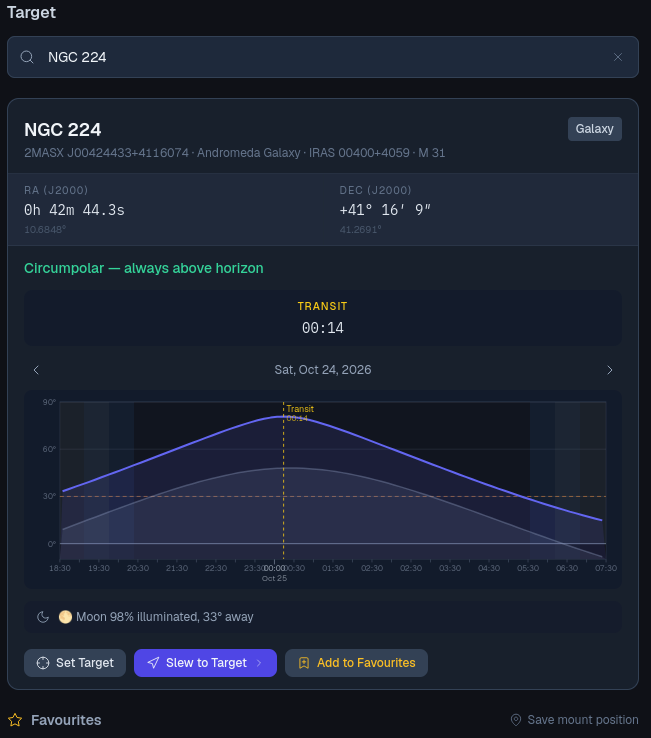

# Target

*Plugin: Target.* Find an object by name, see when it is well placed tonight, and point the
mount at it.

## Searching

Type in the search box: a catalogue number (`M 42`, `NGC 891`, `IC 1795`, `C 14` or `Caldwell 14`, `Sh2-155`, `HIP 677`),
a common name (`Andromeda`, `Heart Nebula`), a bright star (`Vega`) or a planet (`Jupiter`, `Moon`).
An object is listed under its Messier number when it has one, followed by its other names.
Planets and the Moon are placed as seen from your site (the one in the active profile). The
catalogues are
on the telescope computer, so search works without Internet; an online catalogue is used as a
fallback when the network is available.

## The object card

- **Name**, other designations and the object type (Galaxy, Emission Nebula…).
- **RA / Dec (J2000)**.
- **Visibility** from your site: *Circumpolar — always above horizon*, *Never rises from your
  location*, or *Not visible above 30° during darkness*. Otherwise the **Best window** tonight
  and the altitude at which the object peaks.
- **Rise**, **Transit** and **Set** times.
- **Altitude graph** for the night, from dusk to dawn: the object's altitude (bright curve), the
  Moon's (faint curve), the 30° line below which imaging is usually poor, and shaded bands for
  twilight. Use the arrows to look at the **Previous night** or **Next night**, and **Jump to tonight** to come back.
- **Moon**: how much of it is lit and how far it is from the object. A warning appears when it
  is close enough to brighten the sky around the target.

The location comes from the site in the active [profile](../../../../docs/en/profiles.md). Without one the card
says *No observer location set*.

## Actions

- **Set Target** makes it the mount's target without moving. Frames are then named after it.
- **Slew to Target** sets the target and moves the mount there. When more than one mount is
  connected, choose which one in the list next to the buttons.
- **Add to Favourites** keeps it in the list below.

After a slew, use [Plate Solving](../../platesolve/docs/en.md) to centre the object precisely.

## Favourites

Your saved objects, one click away. **Save mount position** saves where the mount points right
now under a name you choose, for spots that are not in any catalogue (a framing you like, a
comet you centred by hand). Each entry shows all the names the object is known by, Messier
number first. Remove an entry with its bin.

Favourites are also offered when you add a task to the [Sequencer](../../sequencer/docs/en.md).
