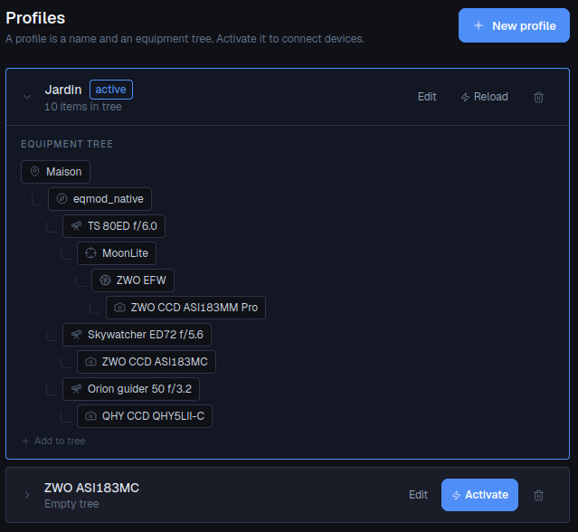

# Profiles

*A profile is a name and an equipment tree. Activate it to connect devices.*

You can have one profile per rig, per location or per configuration: *Backyard*,
*Travel rig*, *Dark site with the big scope*. Exactly one profile is active at a time.



## Creating a profile

1. Click **New profile**.
2. Enter a **Profile name** and click **Create profile**.
3. Unfold the profile and build its **Equipment tree**.

Items come from the [inventory](equipment.md#inventory): add equipment there first.

## The equipment tree

The tree mirrors how your equipment is physically attached. **Add to tree** adds a top-level
item (normally the site). The **+** next to an item (*Attach child item*) adds something under
it; *Remove from tree* takes it out of the tree (it stays in the inventory). Each inventory item can
appear only once in a tree.

What can go under what:

| Item | Can hold |
|---|---|
| Observation Site | Mount, GPS |
| Mount | Telescope / OTA |
| Telescope / OTA | Camera, Focuser, Rotator, Filter Wheel, another Telescope (e.g. a guide scope piggy-backed on the main one) |
| Rotator | Focuser, Filter Wheel, Camera |
| Focuser | Filter Wheel, Camera |
| Filter Wheel | Camera |
| Camera | nothing |

A typical tree with a main scope and a guide scope:

```
Site
└── Mount
    ├── Main telescope
    │   └── Focuser
    │       └── Filter wheel
    │           └── Main camera
    └── Guide scope
        └── Guide camera
```

Each path from a telescope down to a camera is an **optical path**. astrolol uses it to:

- show, on a camera's [Imaging](imaging.md) page, the focuser and filter wheel that sit in
  front of *that* camera;
- know the focal length in front of each camera (image scale for plate solving, guiding and
  FITS headers);
- know which filter wheel the [Sequencer](../../astrolol/plugins/sequencer/docs/en.md), [Autofocus](../../astrolol/plugins/autofocus/docs/en.md) and
  [Flat Wizard](../../astrolol/plugins/flat_wizard/docs/en.md) should drive for a given camera;
- give the mount its location and time from the site.

## Activating

Click **Activate** on a profile. astrolol:

- connects every device in its tree, reporting *Profile activated* or *Activated with errors*
  (each failing device is listed with the reason);
- sends the site's location to the mount;
- records the telescope and site in the FITS headers of every frame you take.

The active profile is marked **active**. On the active profile the button becomes
**Reload**: it reconnects the tree, which is handy after plugging a device back in.

When astrolol restarts, it reactivates the last active profile and reconnects its devices.

## Other actions

- **Edit**: rename the profile.
- The bin deletes the profile. The inventory items are not affected.
