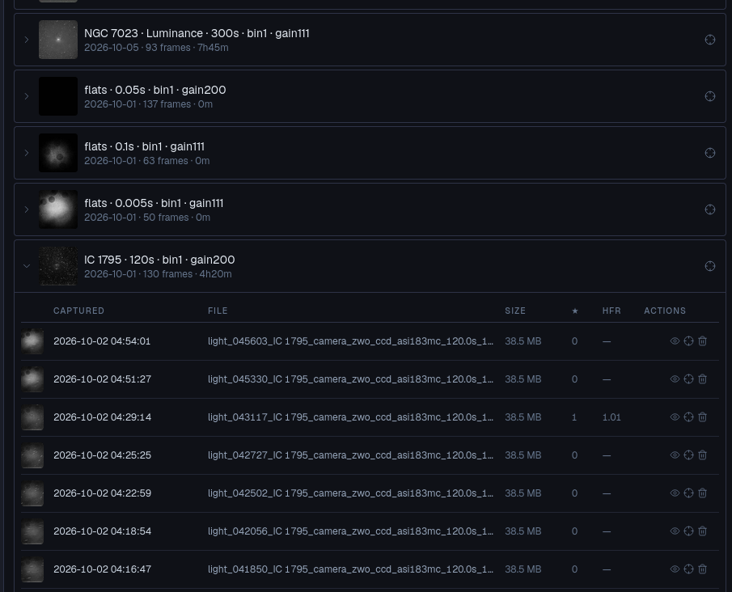

# Viewer

*Plugin: Viewer.* Browse and preview every frame astrolol has captured, without copying files
off the telescope computer.

## Browsing

Frames are grouped by night, target, filter, exposure, binning and gain
(*IC 1795 · 120s · bin1 · gain200 — 2026-10-01 · 130 frames · 4h20m*). Unfold a group to see
its frames: time of capture, file name, size, number of stars and HFR. Turn on
**Flat list (ungrouped)** to see every frame in one list.

Actions on a frame:

- **View** opens it full size. Arrow keys go to the previous and next frame, Esc closes. The
  side panel shows the object, frame type, capture time, exposure, gain, binning, filter,
  camera, telescope, sensor temperature, RA / Dec and quality (stars, HFR). The RA / Dec is the
  plate-solved position when the frame was solved, otherwise the mount's reported position.
  **Download the original FITS** saves the file to your device.
- **Set as target** (the crosshair) makes the frame's coordinates the mount target, without
  slewing; handy to come back to the same framing another night. On a group, it uses the
  group's coordinates.
- **Reject** (the bin) moves the file to a `_rejected/` folder. It is not deleted.

## Filters

**Frame type**, **Object**, **Search** (object or file name), a date range **From** / **To**.
**Clear filters** resets them.

## Totals per object

The integration time collected on each object: number of light frames, total time and number
of nights. Useful to see where a long project stands.

## Library settings

- **Library directory**: the folder the viewer indexes, normally where astrolol saves images.
  Changing it re-scans and forgets frames outside the new folder.
- **Rescan library**: picks up files added or removed by hand.
- **Indexed frames** and **Disk free**.
- **Rejected** frames: **Restore** one, or **Empty rejected (permanent)** to delete them all for
  good.
