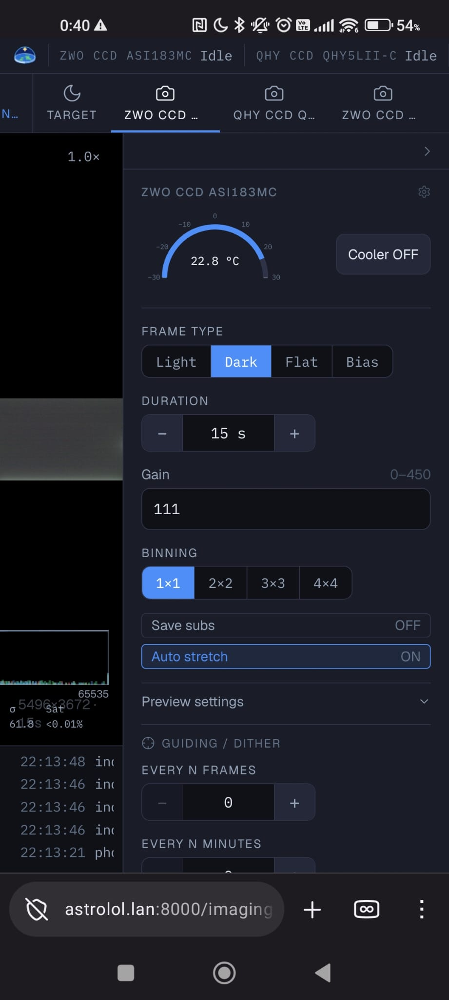

# Imagerie

Il y a une page Imagerie par caméra connectée ; chacune apparaît dans le menu sous le nom de la
caméra. Sans caméra connectée, la page affiche *Aucune caméra connectée.*

La page montre la dernière image au centre, un journal des messages de la caméra, d'INDI et du
guidage en dessous, et les commandes à droite : la caméra, puis le focuser et la roue à filtres
placés devant cette caméra dans le [profil](profiles.md#arborescence-du-matériel) actif.

## L'image

La dernière image est affichée avec la **FWHM** des étoiles (en pixels) et le nombre d'étoiles
trouvées, pratique pour vérifier rapidement la mise au point.

- Molette ou pincement pour zoomer, glisser pour se déplacer. Double-clic (ou **réinit.**) pour
  revenir à la vue entière.
- L'histogramme dans le coin montre la courbe d'étirement et trois valeurs : **Fond** (fond de
  ciel, médiane en ADU ; par canal sur une caméra couleur), **σ** (bruit de fond) et **Sat**
  (part des pixels à pleine échelle). Gardez *Sat* bas sur les images light et surveillez
  *Fond* sur les flats.

## Caméra

**Refroidissement.** Sur une caméra refroidie, la jauge montre la température du capteur, la
consigne et la puissance du refroidissement. Allumez-le avec **Refroid. OUI / NON**, choisissez
la **Cible °C** et cliquez sur **Appliquer**.

**Réglages de pose**

| Réglage | |
|---|---|
| Type d'image | Light, Dark, Flat ou Bias. Écrit dans l'en-tête FITS et le nom de fichier. |
| Durée | − / +, ou cliquez sur la valeur pour saisir n'importe quelle durée. |
| Gain | Le gain de la caméra ; la plage valide est affichée à côté. |
| Binning | De 1×1 à 4×4. |
| Enregistrer les poses | Sur OUI, chaque image est enregistrée en FITS (voir [Options → Enregistrement des images](options.md#enregistrement-des-images)). Sur NON, les images sont seulement affichées. |
| Étirement auto | Sur OUI, chaque aperçu est étiré pour faire ressortir les détails faibles. Sur NON, vous voyez les données linéaires. |

Ces réglages sont mémorisés par caméra.

**Réglages de l'aperçu** (dépliable) ne changent que l'affichage, jamais le fichier
enregistré :

- **Ajuster** l'image à la fenêtre, ou **1x** (un pixel de l'image par pixel de l'écran).
- **Qualité JPEG** : à baisser sur une liaison Wi-Fi lente.
- **Étirement** : *doux*, *normal* ou *fort* ; **Avancé** règle le niveau du fond de ciel et
  l'écrêtage des ombres.
- Sur une caméra couleur : affichage en **RVB** ou **Mono**, avec les canaux **liés** ou
  **indépendants** (indépendants équilibre chaque couleur séparément, ce qui retire la
  dominante due à la pollution lumineuse).

**Guidage / Dither.** Quand un guideur tourne ([Guideur](../../astrolol/plugins/guider/docs/fr.md),
[PHD2](../../astrolol/plugins/phd2/docs/fr.md) ou le
[Simulateur de guidage](../../astrolol/plugins/guide_simulator/docs/fr.md)), astrolol peut faire
un dithering entre les images pendant une boucle : **Toutes les N images** ou **Toutes les N
minutes** (0 = désactivé ; régler l'un remet l'autre à zéro).

**Boutons**

- **Poser** prend une image.
- **Boucle** prend des images l'une après l'autre jusqu'à ce que vous cliquiez de nouveau
  (**Stop**). La barre d'état affiche *Boucle* avec le temps écoulé.
- **Arrêt** interrompt la pose en cours et annule la boucle immédiatement.

Pour une nuit planifiée avec plusieurs cibles et filtres, utilisez le
[Séquenceur](../../astrolol/plugins/sequencer/docs/fr.md).

## Focuser

Affiché quand le profil place un focuser devant cette caméra.

- La règle montre la position actuelle.
- **Rentrer** / **Sortir** de la **Taille du pas**.
- **Position absolue**, puis **Aller**, pour aller à une position donnée.
- **Arrêt** stoppe un déplacement.

Pour une mise au point automatique, voir l'[Autofocus](../../astrolol/plugins/autofocus/docs/fr.md).

## Roue à filtres

Affichée quand le profil place une roue à filtres devant cette caméra. Cliquez sur un filtre
pour y aller ; les noms viennent de l'[inventaire](equipment.md#inventaire) (*Filtre 3* s'il
n'a pas de nom).

## Propriétés de l'appareil

La roue dentée à côté du titre de la caméra, du focuser ou de la roue à filtres ouvre la liste
complète des réglages du pilote (*Propriétés INDI*). Voir
[Propriétés des appareils](interface.md#propriétés-des-appareils).
