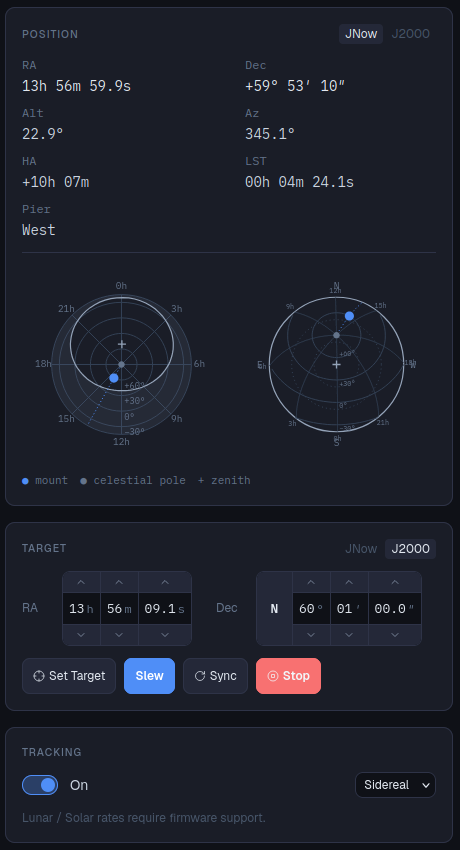

# Monture

La page Monture montre où pointe la monture et permet de la déplacer. Sans monture connectée,
elle affiche *Aucune monture connectée.* : connectez-en une dans [Matériel](equipment.md) ou
activez un [profil](profiles.md).

## Position

Le pointage actuel :

| | |
|---|---|
| AD / Dec | Coordonnées équatoriales. Basculez entre **JNow** (de la date, comme la monture voit le ciel) et **J2000** (comme les catalogues les donnent). |
| Haut. / Az | Hauteur au-dessus de l'horizon et azimut. |
| AH | Angle horaire : la distance de la monture au méridien. |
| TSL | Temps sidéral local. |
| Côté | De quel côté du pilier se trouve le télescope (Est / Ouest), et dans combien de temps (ou depuis combien de temps) il passe le méridien. |

Deux cartes du ciel montrent la position de la monture : l'une centrée sur le **pôle céleste**
(vue équatoriale), l'autre sur le **zénith** (vue horizontale, ce que vous voyez debout sous le
ciel).

La position et l'heure viennent du site du profil actif : vérifiez le site si la hauteur ou
l'angle horaire semblent faux.

## Cible

Les champs suivent la position de la monture tant que vous ne les modifiez pas. Saisissez des
coordonnées (AD en heures, minutes, secondes ; Dec en degrés, minutes, secondes, avec N/S) ou
utilisez les flèches au-dessus et en dessous de chaque champ. Les coordonnées se saisissent en
**J2000** par défaut ; passez en **JNow** si les vôtres sont de la date. Une fois les champs
modifiés, **↺ direct** leur fait de nouveau suivre la monture.

- **Définir la cible** enregistre la cible sans bouger (elle sert à nommer les images et aux
  autres pages).
- **Pointer** y envoie la monture.
- **Synchroniser** dit à la monture qu'elle pointe ces coordonnées, ce qui corrige son pointage.
  À n'utiliser que si vous savez où pointe vraiment le télescope ; la
  [résolution astrométrique](../../astrolol/plugins/platesolve/docs/fr.md) le fait pour vous.
- **Stop** interrompt un pointage.

Le plus simple pour définir une cible est de passer par la page
[Cible](../../astrolol/plugins/target/docs/fr.md).

## Suivi

L'interrupteur active ou coupe le suivi. La liste choisit la vitesse : **Sidéral** (étoiles),
**Lunaire** ou **Solaire** (ces deux dernières seulement si le firmware de la monture les
gère). Le suivi ne peut pas être activé tant que la monture est parquée.

## Parcage

- **Parquer** envoie la monture à sa position de parcage et arrête le suivi ; **Déparquer** la
  libère.
- **Définir comme position de parcage** fait de la position actuelle la position de parcage.
- **Parquer automatiquement à** une heure locale, par exemple 06:00, pour que la monture soit à
  l'abri à l'aube même si vous dormez.

## Méridien et horizon

- **Retournement au méridien** fait passer la monture de l'autre côté du pilier. Le bouton
  explique quand ce n'est pas possible : le méridien n'est pas encore franchi, la monture est
  déjà du bon côté, ou elle est à plus de 2 h après le méridien (pointez plutôt la cible).
- **Retourner automatiquement quand AH >** un nombre d'heures après le méridien.
- **Limite du méridien** : de combien l'axe AD peut tourner au-delà du méridien, dans les deux
  sens. Au-delà, le suivi s'arrête et les pointages sont refusés. Appliquée par les montures qui
  la gèrent (le pilote [EQMOD](../../astrolol/plugins/eqmod/docs/fr.md)) ; les pilotes INDI
  gardent leurs propres limites.
- **Limite d'horizon** : un horizon plat, en degrés de hauteur. Les GoTo en dessous sont
  refusés. Quand une monture en suivi passe en dessous, astrolol fait une fois ce que vous avez
  choisi : **arrêter le suivi**, **parquer** ou **ne rien faire**.

Si vous imagez avec le [Séquenceur](../../astrolol/plugins/sequencer/docs/fr.md), laissez-le
gérer les retournements : il les fait entre deux images plutôt qu'au milieu d'une pose.

## Corrections

Les flèches déplacent la monture vers le **Nord**, le **Sud**, l'**Est** et l'**Ouest** tant que vous
les maintenez. Le bouton rouge au centre arrête d'un coup tout déplacement, y compris un pointage en cours.

La vitesse affichée au-dessus des flèches est un multiple de la vitesse sidérale, de 1× (le rythme des
étoiles) à 800×. Utilisez **−** et **+** pour la changer ; astrolol retient la vitesse de cette monture. Les montures qui
fournissent leur propre liste de vitesses (via INDI) proposent cette liste.

## Propriétés de l'appareil

La roue dentée à côté du nom de la monture ouvre la liste complète des réglages du pilote. Voir
[Propriétés des appareils](interface.md#propriétés-des-appareils).
